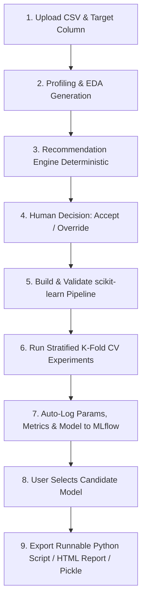

# Panduan Lengkap Kode & Arsitektur ML-Autonomus
> **Dokumen ini dibuat untuk mempermudah delegasi ke developer baru atau orang awam.**
> Berisi audit kualitas kode, peta struktur file, penjelasan modul baris per modul, alur data (dataflow), dan petunjuk pengembangan.

---

## 1. Hasil Audit Kualitas Kode (Code Audit Summary)

Setelah pemeriksaan menyeluruh ke seluruh berkas repository:
- **TIDAK ADA Spaghetti Code**: Kode telah terstruktur dengan rapi menggunakan arsitektur Monorepo yang memisahkan antara **ML Engine** (murni Python tanpa dependensi web), **Backend API** (FastAPI), dan **Frontend UI** (React + Vite).
- **Prinsip Clean Code (DRY & SRP)**: Seluruh fungsi duplikat telah direfaktorisasi (misalnya helper rekonstruksi profile yang kini terpusat di `apps/api/routers/utils.py`).
- **Data Leakage-Safe**: Proses pra-pemrosesan data (*preprocessing*) diuji terisolasi agar tidak mengalami kebocoran data (*data leakage*) pada *training/test fold*.

---

## 2. Peta Struktur Proyek (Directory Map)

```
ml-autonomus/
├── packages/
│   └── ml_engine/                # 🧠 ENGINE UTAMA (Pure Python ML Package)
│       ├── profiling/            # Deteksi profil dataset (kolom, statistik, skewness)
│       ├── detection/            # Detector spesifik (missing, outlier, class imbalance, data leakage)
│       ├── eda/                  # Generator chart/grafik untuk visualisasi data
│       ├── recommendations/      # Engine penentu rekomendasi preprocessing deterministik
│       ├── preprocessing/        # Pembentuk scikit-learn Pipeline (Winsorizer, FrequencyEncoder)
│       ├── models/               # Registri algoritma model (RandomForest, LogisticRegression, dll)
│       ├── evaluation/           # Evaluator Cross-Validation (K-Fold, StratifiedKFold)
│       ├── experiments/          # Eksekutor runner eksperimen & penyimpan artefak
│       ├── export/               # Generator kode Python (.py) & laporan ringkasan (.html)
│       ├── tracking/             # Modul integrasi ke MLflow Tracking & Model Registry
│       ├── assistant/            # Engine narasi AI Assistant (Explainer & Next-Step guide)
│       └── serving/              # Engine live inference & model prediction
├── apps/
│   ├── api/                      # 🔌 BACKEND API (FastAPI + SQLAlchemy)
│   │   ├── main.py               # Entrypoint FastAPI server
│   │   ├── config.py             # Pengaturan aplikasi & storage path
│   │   ├── database.py           # Koneksi SQLite database
│   │   ├── db_models/            # ORM Database Models (projects, datasets, experiments, dll)
│   │   ├── schemas/              # Schema validasi Pydantic (Request/Response)
│   │   └── routers/              # Endpoint REST API (projects, datasets, recommendations, serving, dll)
│   └── web/                      # 💻 FRONTEND DASHBOARD (React 18 + Vite + Tailwind v4)
│       ├── src/
│       │   ├── App.tsx           # Router navigasi utama
│       │   ├── api/client.ts     # Helper panggilan API Backend (axios)
│       │   ├── components/       # Komponen UI (Sidebar, AIAssistantWidget)
│       │   └── pages/            # 7 Halaman Alur Kerja (Upload, EDA, Treatment, Result/Serving, dll)
├── tests/                        # 🧪 UNIT TESTS (112 test Pytest, 100% Passed)
├── Dockerfile & docker-compose   # 🐳 Containerization Production Setup (WSL Docker)
└── docs/                         # 📚 DOKUMENTASI LENGKAP
```

---

## 3. Penjelasan Detail Modul demi Modul

### 🧠 A. ML Engine Core (`packages/ml_engine/`)

Modul ini adalah **otak utama machine learning**. Kode di dalam folder ini tidak bergantung pada web server sehingga sangat mudah diuji (*testable*) dan dipakai di tempat lain.

#### 1. `profiling/profiler.py`
- **Fungsi Utama**: Membaca dataframe Pandas dan menganalisis profil setiap kolom secara otomatis.
- **Apa yang Dihitung?**:
  - `dtype`: Deteksi tipe data (numerik, kategorikal, boolean, datetime, identifier).
  - `missing_count` & `missing_rate`: Persentase data kosong pada kolom.
  - `skewness` & `kurtosis`: Mengukur kemiringan distribusi data untuk menentukan perlunya *scaler* atau *imputer* tertentu.
  - `duplicate_rows`: Jumlah baris duplikat di dataset.

#### 2. `detection/` (`missing_detector.py`, `outlier_detector.py`, `imbalance_detector.py`, `leakage_detector.py`)
- **Fungsi Utama**: Detektor spesifik untuk mengidentifikasi masalah pada dataset.
- **Deteksi Outlier**: Gunakan aturan IQR (*Interquartile Range*) dan *Robust Z-Score* untuk menemukan baris bernilai ekstrem.
- **Deteksi Class Imbalance**: Menghitung rasio perbandingan kelas target (misal target biner `0: 90%` dan `1: 10%`).
- **Deteksi Data Leakage** (`leakage_detector.py`): Detektor kebocoran data dua-mode yang dieksekusi **sebelum** semua rekomendasi lain:
  - *Identifier Detection*: Menandai kolom ID/UUID/index baris (unique ratio ≥ 95% pada integer/string). Kolom **float** dikecualikan karena nilai desimal kontinu memang cenderung unik.
  - *Target Proxy Detection*: Menghitung korelasi Pearson + Spearman (numerik), Point-Biserial (target biner), dan Cramér's V (kategorikal). Threshold: 0.95 (numerik) / 0.90 (kategorikal).
  - *Severity*: `critical` (≥ 0.98 / identifier), `high` (≥ 0.95), `medium` (≥ threshold).

#### 3. `recommendations/engine.py`
- **Fungsi Utama**: *Decision Engine* yang menentukan rekomendasi pra-pemrosesan data berdasarkan bukti statistik.
- **Aturan Keputusan (Contoh)**:
  - Jika skewness > 1.0 pada data numerik yang ber-outlier → Rekomendasikan `median_imputation` & `robust_scaling`.
  - Jika data kategorikal memiliki nilai unik sedikit → Rekomendasikan `one_hot_encoding`.
  - Setiap rekomendasi diberi skor keyakinan (*confidence score* 0–100) dan bukti statistik (*evidence*).

#### 4. `preprocessing/` (`pipeline_builder.py`, `transformers.py`, `feature_engineering.py`)
- **Fungsi Utama**: Membangun `ColumnTransformer` dan `Pipeline` scikit-learn secara otomatis dari keputusan user.
- **Custom Transformers**:
  - `AutoFeatureEngineer`: Mengaplikasikan transformasi `log1p` pada kolom numerik yang sangat miring dan menghasilkan fitur interaksi produk antar fitur numerik utama.
  - `Winsorizer`: Pemotong nilai outlier ekstrem ke batas IQR tanpa menghapus baris.
  - `FrequencyEncoder`: Mengodekan kategori berdasarkan frekuensi kemunculannya.
- **Keamanan Leakage**: `Pipeline` memastikan `fit()` hanya dijalankan pada *training fold*, sehingga mencegah data leaking.

#### 5. `models/registry.py`
- **Fungsi Utama**: Registri tempat mendaftarkan algoritma machine learning yang tersedia, mendukung Klasifikasi (`random_forest`, `logistic_regression`, `linear_svm`, `gradient_boosting`, `knn`, `dummy_classifier`) dan Regresi (`linear_regression`, `ridge`, `random_forest_regressor`, `gradient_boosting_regressor`, `hist_gradient_boosting_regressor`, `knn_regressor`, `dummy_regressor`, serta adapter XGBoost & LightGBM).

#### 6. `evaluation/evaluator.py`
- **Fungsi Utama**: Evaluator Cross-Validation terisolasi (Stratified K-Fold untuk klasifikasi & K-Fold untuk regresi).
- **Metrik & Output**: Menghitung metrik klasifikasi (Accuracy, F1, Precision, Recall, ROC-AUC) atau metrik regresi (`R²`, `MAE`, `MSE`, `RMSE`), serta mengekstrak data residual actual vs predicted.

#### 7. `experiments/` (`runner.py`, `tuner.py`)
- **`runner.py`**: Menjalankan eksperimen CV, menyimpan artefak (`pipeline.pkl`, `config.json`, `metrics.json`), merekam metadata environment, serta menerapkan hiperparameter model hasil tuning (`model_params`) ke estimator pipeline.
- **`tuner.py`**: Engine Hyperparameter Optimization (`RandomizedSearchCV` + KFold / Stratified CV) untuk mencari kombinasi parameter terbaik dengan konfigurasi `n_jobs=1` yang aman dari deadlock multiprocessing di Windows.

#### 8. `tracking/mlflow_tracker.py`
- **Fungsi Utama**: Otomatisasi pendaftaran metrik, parameter, dan model pipeline (`pipeline.pkl`) ke **MLflow Tracking Server** dan **MLflow Model Registry** via `mlflow.sklearn.log_model`. Untuk eksperimen/model hasil hyperparameter tuning, penamaan MLflow run name dan registered model name secara otomatis menyertakan akhiran `_tune` (misalnya `linear_regression_tune`, `random_forest_tune`).

#### 9. `export/` (`code_generator.py`, `report_generator.py`)
- **`code_generator.py`**: Mengubah konfigurasi eksperimen menjadi script Python (`.py`) mandiri scikit-learn pipeline murni tanpa dependensi internal AutoML. Mendukung seluruh model Klasifikasi & Regresi, pembagian dataset terpisah (tanpa `stratify` dan menggunakan `KFold` pada regresi), pencetakan metrik $R^2$, RMSE, dan MAE, format konstruktor dengan hiperparameter hasil tuning (`model_params`), serta penyisipan definisi inline class `AutoFeatureEngineer` jika feature engineering diaktifkan.
- **`report_generator.py`**: Menghasilkan dokumen HTML mandiri ringkasan seluruh workflow proyek, lengkap dengan Confusion Matrix (Klasifikasi) atau tabel metrik regresi ($R^2$, RMSE, MAE) dan ringkasan analisis error/residual (Regresi).

#### 10. `assistant/` (`explainer.py`, `llm_provider.py`)
- **`explainer.py` (Fungsi Utama)**: Engine *Natural Language Generation* (NLG) deterministik murni berbasis aturan sesuai keputusan **ADR-003**. Bekerja tanpa ketergantungan model/API pihak ketiga, menghasilkan penjelasan instan (<1ms) dan 100% akurat berbasis statistik nyata:
  - **Penjelasan Rekomendasi ("Why was this recommended?")**: Mengurai bukti statistik profiling (`missing_rate`, `skewness`, `outlier_rate`, `cardinality`, `sample_size`) untuk menjelaskan alasan ilmiah pemilihan tindakan (misal: kenapa Median dipilih dibanding Mean karena distribusi miring/adanya outlier).
  - **Ringkasan Eksperimen Multi-Task**: Merangkum hasil evaluasi model secara kontekstual baik untuk Klasifikasi (perankingan F1-Score, Akurasi, ROC-AUC) maupun Regresi (perankingan $R^2$ Score, RMSE, dan MAE).
  - **Panduan Alur Kerja (`suggest_next_step`)**: Memandu pengguna langkah demi langkah dari Upload ➔ EDA ➔ Treatment ➔ Pipeline ➔ Experiments ➔ Result.
- **`llm_provider.py`**: Adaptor opsional untuk *enrichment* naratif via model LLM eksternal (misal Gemini API) dengan mekanisme *graceful fallback* ke Rule-Based jika offline atau tanpa API key.

#### 11. `serving/` (`inference.py`)
- **Fungsi Utama**: Engine inferensi *real-time* yang memuat artefak `pipeline.pkl` dan mengeksekusi prediksi langsung pada data fitur mentah.
- **Transparansi Preprocessing**: Klien tidak perlu melakukan scaling atau encoding manual; seluruh tahapan imputer, winsorizer, encoder, dan scaler dieksekusi secara otomatis di dalam pipeline.
- **Multi-Format & Multi-Task**: Menerima single record dict, batch list of dicts, maupun pandas DataFrame. Menyajikan label kelas & *confidence score* untuk Klasifikasi serta nilai kontinu untuk Regresi.

---

### 🔌 B. Backend API (`apps/api/`)

Backend menggunakan **FastAPI** untuk menyediakan REST API yang dikonsumsi oleh Frontend.

1. **`main.py`**: Menginisialisasi aplikasi FastAPI, mendaftarkan CORS, dan menyambungkan *routers*.
2. **`config.py`**: Pengaturan aplikasi seperti direktori penyimpanan artefak (`./storage`).
3. **`database.py`**: Inisialisasi koneksi SQLite database (`automl.db`).
4. **`db_models/orm.py`**: Definisi tabel database (`projects`, `datasets`, `workflow_decisions`, `pipeline_configs`, `experiments`, `metrics`, `artifacts`).
5. **`routers/`**:
   - `projects.py`: CRUD proyek (dukungan `task_type`: `classification` / `regression`).
   - `datasets.py`: Upload CSV, ambil profil data, chart EDA, & visualisasi scaling preview before vs after.
   - `recommendations.py`: Ambil rekomendasi & simpan keputusan user.
   - `pipelines.py`: Buat konfigurasi pipeline & jalankan validasi dry-run.
   - `experiments.py`: Eksekusi training eksperimen klasifikasi & regresi, hyperparameter tuning (`POST /experiments/tune`), penanganan flag `is_tuned`, registrasi resmi model ke MLflow Model Registry via `mlflow.sklearn.log_model`, endpoint residual plot, ekspor kode `.py`, dan ekspor laporan `.html`.
   - `assistant.py`: Endpoint penjelasan AI Assistant & panduan alur kerja yang meneruskan `task_type` (klasifikasi/regresi) untuk memastikan ketepatan ringkasan benchmark.
   - `serving.py`: Endpoint produksi untuk inferensi live model kandidat (`GET /models/candidate/schema`, `POST /predict`, dan `POST /predict/batch-csv`).

---

### 💻 C. Frontend Web (`apps/web/src/`)

Frontend dibangun menggunakan **React 18 + TypeScript + Vite + Tailwind CSS v4** dengan sistem desain **Soft Light Clay Neumorphism (Soft UI)** yang bersih, halus, solid tanpa gradasi berlebih, serta mengeliminasi 100% Unicode emoji menjadi semantic SVG icons dari `lucide-react`.

- **Neumorphism Design System (`index.css`)**:
  - **Surface & Palette**: Warna clay lembut matte (`#e6ecf4` base, surface, dan card; `#dde5ef` recessed inset; `#edf2f8` elevated).
  - **Refined Subtle Shadows**: Bayangan taktil halus tanpa efek bengkak berlebihan (`-3px -3px 8px rgba(255,255,255,0.95)` dan `3px 4px 10px rgba(166,178,195,0.35)`).
  - **Recessed Inset Shadows**: Cekungan fisik lembut (`inset 2px 2px 5px rgba(166,178,195,0.35), inset -2px -2px 5px rgba(255,255,255,0.9)`).
  - **Solid Tactile Controls**: Tombol dan logo otak solid tanpa gradasi berlebihan (`#7c3aed` solid purple untuk logo, `#4338ca` solid indigo untuk primary button).
  - **Card Sizing Consistency**: Menggunakan grid `align-items: stretch` dengan kontainer dropzone dan konfigurasi berukuran tinggi serasi (`min-height: 260px`).
  - **Responsive Design System**: Mendukung layar desktop, tablet, dan smartphone dengan bar navigasi mobile atas (`mobile-top-bar`), backdrop drawer (`sidebar-overlay`), dan tombol hamburger toggle.
  - **Robust Error Handling**:
    - `components/ErrorBoundary.tsx`: Menangkap runtime crash rendering React secara anggun dengan tombol pemulihan *Muat Ulang Halaman*.
    - `api/client.ts`: Axios response interceptor otomatis mengekstrak pesan validasi FastAPI (Pydantic `detail`) menjadi string yang ramah pengguna.
    - `apps/api/main.py`: Global exception handler FastAPI menangkap uncaught internal error dan mengembalikan JSON 500 terstruktur.

1. **`pages/DashboardPage.tsx`**: Halaman utama untuk membuat proyek (Klasifikasi / Regresi) atau memilih proyek.
2. **`pages/UploadPage.tsx`**: Halaman pengunggahan file CSV dataset dan pemilih kolom target (*label*) dengan kartu dropzone dan konfigurasi seimbang.
3. **`pages/EDAPage.tsx`**: Halaman 5-tab visualisasi eksplorasi data (Overview, Missing, Distributions, Correlations, Target).
4. **`pages/TreatmentPage.tsx`**: Halaman kartu keputusan preprocessing & preview visualizer histogram Before vs After Scaling. Menyediakan tombol *Ask AI* dengan parsing bukti statistik fleksibel (`=` dan `:`) agar modal penjelasan menyajikan angka nyata.
5. **`pages/PipelinePage.tsx`**: Visualisasi DAG pipeline scikit-learn dan tombol uji validasi pipeline dengan icon komponen taktil.
6. **`pages/ExperimentsPage.tsx`**: Halaman seleksi algoritma model (Klasifikasi / Regresi), toggle Auto Feature Engineering, pengaturan CV Folds, tombol `Tune` kontekstual pada setiap baris hasil eksperimen selesai dan kartu *Best Model*, modal Hyperparameter Tuning dengan pencarian Randomized Search, tombol *Run & Register Tuned Model*, kartu ringkasan **AI Benchmark Summary**, serta mekanisme *live polling* reaktif setiap 2 detik yang otomatis meng-update tabel dan ringkasan AI seketika eksperimen selesai.
7. **`pages/ResultPage.tsx`**: Halaman hasil akhir yang menampilkan statistik performa kandidat terpilih, Confusion Matrix (Klasifikasi) atau Scatter Plot Actual vs Predicted & Residuals (Regresi), panel interaktif **Live Model Serving & Inference Playground** (form prediksi dinamis input mentah, batch upload CSV data baru, dan generator kode API cURL & Python), serta tombol download artefak (`.pkl`, `.json`, `.py`, `.html`).
8. **`components/AIAssistantWidget.tsx`**: Drawer pembimbing AI melayang di sudut kanan bawah dengan styling neumorphic yang mengenali seluruh alur halaman termasuk tahapan eksplorasi data (`/eda`).
9. **`components/ErrorBoundary.tsx`**: Komponen penangkap galat runtime React untuk mencegah layar putih kosong saat terjadi error tak terduga.

---

## 4. Alur Kerja Data (Dataflow dari A sampai Z)



---

## 5. Panduan untuk Developer Baru / Delegasi

### Cara Menjalankan Aplikasi di Komputer Lokal:

1. **Buka Terminal 1 (Backend FastAPI)**:
   ```bash
   cd apps/api
   python -m uvicorn main:app --reload --port 8000
   ```
2. **Buka Terminal 2 (Frontend React)**:
   ```bash
   cd apps/web
   npm run dev
   ```
3. **Buka Terminal 3 (MLflow Dashboard - Opsional)**:
   ```bash
   mlflow ui
   ```

### Tempat Mengedit Kode Jika Ingin Menambah Fitur:
- **Menambah Model ML Baru**: Edit file [packages/ml_engine/models/registry.py](file:///d:/ml-autonomus/packages/ml_engine/models/registry.py).
- **Menambah Aturan Preprocessing Baru**: Edit file [packages/ml_engine/recommendations/engine.py](file:///d:/ml-autonomus/packages/ml_engine/recommendations/engine.py).
- **Menambah Fitur Inferensi & Serving**: Edit file [packages/ml_engine/serving/inference.py](file:///d:/ml-autonomus/packages/ml_engine/serving/inference.py) dan [apps/api/routers/serving.py](file:///d:/ml-autonomus/apps/api/routers/serving.py).
- **Menambah Uji Statistik Drift Monitoring**: Edit file [packages/ml_engine/monitoring/drift_detector.py](file:///d:/ml-autonomus/packages/ml_engine/monitoring/drift_detector.py) dan [apps/api/routers/monitoring.py](file:///d:/ml-autonomus/apps/api/routers/monitoring.py).
- **Menambah Deteksi Leakage Baru**: Edit file [packages/ml_engine/detection/leakage_detector.py](file:///d:/ml-autonomus/packages/ml_engine/detection/leakage_detector.py) — sesuaikan threshold atau tambah mode deteksi baru. Update `__init__.py` di folder `detection/` jika menambah export publik.
- **Menambah Halaman Frontend Baru**: Tambahkan file di `apps/web/src/pages/` dan daftarkan rutenya di [apps/web/src/App.tsx](file:///d:/ml-autonomus/apps/web/src/App.tsx).

---

## 6. Panduan Menjalankan Docker di WSL (Production Mode)

Proyek ini telah dilengkapi dengan `Dockerfile` backend & frontend serta `docker-compose.yml` untuk deployment container di WSL2:

### Langkah Menjalankan:
1. **Buka Terminal WSL**:
   ```bash
   cd /mnt/d/ml-autonomus
   ```
2. **Pastikan Server Lokal Windows Sudah Dimatikan** (agar port 8000 & 3000 tidak bentrok).
3. **Bangun & Jalankan Seluruh Container**:
   ```bash
   docker compose up --build -d
   ```
4. **Cek Status Container**:
   ```bash
   docker compose ps
   ```
5. **Akses Layanan dari Browser Windows**:
   - **Frontend Web Dashboard**: `http://localhost:3000`
   - **Backend FastAPI API & Docs**: `http://localhost:8000/docs`
   - **MLflow Tracking Server**: `http://localhost:5000`
6. **Untuk Menghentikan Container**:
   ```bash
   docker compose down
   ```

---

*Dokumen ini diperbarui secara otomatis dan menjadi acuan utama pengembangan.*
